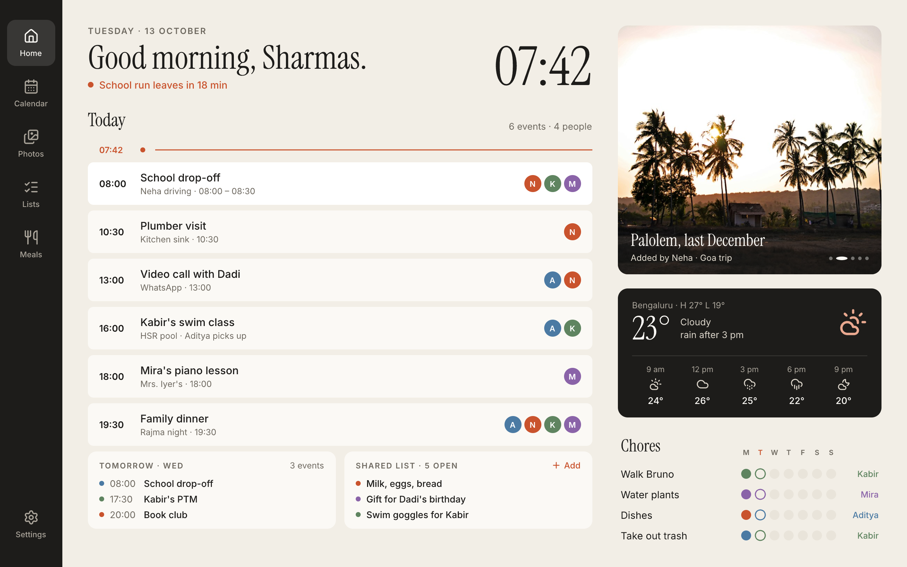

# CAUTION

This project is very early in development. The functionality is very barebones, the basic GUI works, there is no real calendar, or any data integration for now. It will come in time, this was a quick spike to explore if this was a viable direction at all. Seems like it is so I will continue to build on top of it. If you're interested in collaborating, you're more than welcome to fork , and contribute.


# Family Frame — Slint photoframe dashboard (prototype)

A Rust + [Slint](https://slint.dev) family dashboard for a wall/counter
photo frame (1280×800 landscape, portrait reflow).


## Run it

```bash
cargo run            # debug
cargo run --release  # what you'd ship
```

Useful env vars:

| Var | Effect |
|---|---|
| `FRAME_LAT`, `FRAME_LON`, `FRAME_CITY` | Weather location + label (default Seattle). Weather is live from [Open-Meteo](https://open-meteo.com/en/docs), no key. Offline → demo values stay. |
| `FRAME_NOW=21:40` | Pretend it's that time today (preview the agenda at other times). |
| `FRAME_SIZE=800x1280` | Open the window at that size (portrait preview). |
| `FRAME_TAB=0..5` | Start on a tab: Home, Calendar, Photos, Lists, Meals, Settings. |
| `FRAME_SETTINGS=path.json` | Settings file (default `~/.config/family-frame/settings.json`). |
| `FRAME_PHOTOS=dir` | Folder of `.jpg`/`.jpeg` photos, oldest EXIF date first (default `assets/photos`, also the fallback when the folder is empty). Captions are the EXIF month and year. |
| `FRAME_THUMB_CACHE=dir` | Directory for stored grid thumbnails, built once per photo version (default `$XDG_CACHE_HOME/family-frame/thumbs`, else `~/.cache/family-frame/thumbs`). Empty disables the store. |
| `FRAME_SCREENSAVER=1` | Start in the screensaver (screenshots). |
| `FRAME_FORCE_URGENT=1` | Pulse the "next up" dot as if an event is ≤15 min away. |
| `FRAME_CACHE_MAIN_CONTENT=0` | Disable Agenda heading/rows, navigation button layouts, and Settings heading/card-body caches for comparison. Enabled by default in frame builds. Moving notches, Header, Chores, and animated control outlines draw directly. |
| `FRAME_CACHE_DASHBOARD=0` | Disable the summary and weather caches for comparison. |
| `FRAME_IDLE_DIM_SECONDS=180`, `FRAME_IDLE_BRIGHTNESS=20` | Frame builds dim after three minutes of human inactivity. Touch restores `FRAME_DAY_BRIGHTNESS` (65%). Set the timeout to `0` to disable. |
| `FRAME_NIGHT_START=22:00`, `FRAME_NIGHT_END=06:00` | Opt into a night window interpreted in the configured time zone (Settings tab; `System` follows the OS). Idle brightness becomes `FRAME_NIGHT_BRIGHTNESS` (10%); touch restores 65%. Automatic slides pause during this window. |
| `FRAME_AUTO_ROTATE=0` | Disable calibrated SC7A20 rotation in frame builds. See [calibration and configuration](docs/orientation.md). |
| `FRAME_PHOTO_SCRIM=svg` / `baked` | Select an SVG caption overlay or a ramp fused into decoded photos. Frame builds default to `baked`; desktop builds default to `svg`. |
| `FRAME_METRICS_OUTPUT=/absolute/external/run.json`, `FRAME_BENCHMARK=1` | Capture the scripted frame workload after warmup. See [measurement instructions](docs/performance.md). |

## Data seams (where real sources plug in)

| Area | File | Today |
|---|---|---|
| Calendar | `src/calendar.rs` → `CalendarSource::events_on(day)` | `DemoCalendar` (fake events anchored to the real date). Implement the trait for CalDAV / Google / ICS and swap it in `main.rs`. |
| People, chores, shared list | `src/household.rs` | Demo data |
| Photos | `src/photos.rs` | Real JPEGs from `FRAME_PHOTOS`; only the photos around the one shown, plus the last-viewed grid range of thumbnails, stay decoded |
| Weather | `src/weather.rs` | Live Open-Meteo |
| Settings | `src/settings.rs` | Themes, fonts, text size, clock, motion, photo transition, screensaver delay; JSON on disk |

Everything the UI shows lives in the `Frame` global (`ui/data.slint`);
Rust fills it, the UI never computes data.

## Design tokens

`ui/tokens.slint` holds every spacing, radius, size, type, opacity, motion
(durations + easings) and scroll-physics value, named by role. Colors per
theme live in `src/settings.rs` (`themes()`), exposed as `Theme.c.*`
(`ui/theme.slint`). Edit a token once; every component follows. The caption
alpha ramp lives in `ui/images/photo-scrim.svg` and is shared by the SVG and
baked-photo modes. `build.rs` enforces this on every build (including
`cargo clippy`/`cargo test`): raw colors, lengths, or durations in
components, unused tokens or imports, and drift between the Rust and
Slint copies of the Linen palette fail the build with file:line messages.

## Agenda behavior

- Events split at "now": ended events sit above the now line and are
  scrolled out of view, so the next event is at the top (highlighted).
- Drag to look back. The scroller has weight: momentum with friction,
  rubber-band past the ends, spring settle (`ui/scroll.slint`). After 15 s
  idle it springs back to now; when an event ends, the list glides on.
- When everything's over: "That's everything for today." + tomorrow's first event.

## Settings tab

Theme (Linen, Sage, Harbor, Paper, Night), headline font (Instrument
Serif, DM Serif Display, Young Serif, or same as body), body font (Inter,
Atkinson Hyperlegible), text size (100/112/125%), 24/12-hour clock, motion
(Full / Calm / Off), photo transition (Slide / Fade), screensaver
delay (Never / 1 / 2 / 5 min), and time zone (System or a curated IANA
zone; drives the clock, agenda, and night windows). Applies live, saved on
change. Theme switches dip
through the page color.

## Performance on the frame

The PF1007L runs FemtoVG through GLES 2 and Mesa Lima at 800×1280.
FemtoVG redraws the whole screen for each animated frame. Stable content
caches reduce repeated drawing; they do not add damage-region rendering.
Home appears immediately, and Home and Settings retain their state across
tab changes. Urgent indicators stop after three pulses. The slideshow
advances every two minutes with Full motion; Calm, Off, hidden Home, and
configured night windows stop automatic advances. Taps still advance photos. Current source
defaults to slides and uses baked caption ramps in frame builds.

Photos are decoded and cover-cropped on a worker thread, cached after a
complete batch, and sized to the ceiling of the card's physical pixel
dimensions. Only the two photos in a transition draw. Scroll physics samples
closed-form coast and spring motion at each animation frame, with no scroll
timer. Press feedback uses colors or leaf opacity instead of fading a whole
complex card. The baked mode composites the shared SVG ramp during decode;
GPU readback verified unchanged upper photo pixels and at most 2/255 channel
difference in the caption region.

Measured at a matched 144 MHz GPU setting, the earlier baseline consumed
about 25–29 CPU seconds per 60-second workload; the optimized build consumed
3.3–3.4 CPU seconds. Animation cadence improved from roughly 10 to 15 FPS.
At the restored 384 MHz setting, an intermediate optimized build reached
about 29 FPS. A later timing probe found most Home frame time in the wait
for the previous DRM page flip. The verified build with correct photos
runs at about 28–29 FPS under the normal GPU policy at checkpoint `9e34868`,
which is retained as a rollback. Production release `b27b4b6f` uses the
follow-up changes. Matched
captures reached roughly 59 FPS during warmed Home returns with both cache
groups and baked ramps. Matched photo slides improved median cadence from
34.04 to 17.12 ms, but about a quarter of warmed intervals still exceeded
25 ms. Caching static Settings card bodies brought its warmed median
from 33.84 to 16.85 ms. Stable 60 FPS has not been demonstrated.
See [performance evidence and reproduction](docs/performance.md).

The GPU scales between its existing 144/240/384 MHz operating points and
runtime-suspends when idle. The temperature service preserves the stock
85/95 °C frequency ceilings. The SC7A20 accelerometer is bound and returns
XYZ readings. Frame builds use a four-pose calibration to rotate the UI and
touch coordinates together. See [rotation setup](docs/orientation.md).

The release build uses LTO, one codegen unit, `panic = "abort"`, and stripping.
The frame cross-build targets Cortex-A7 with NEON; this does not establish an
ARMv7 JPEG SIMD speedup.

`scripts/build-frame.sh` enables the pinned Slint 1.18.1 image anti-aliasing
correction by default. Set `PF_FEMTOVG_IMAGE_AA_FIX=0` at build time to compare
without it; desktop `cargo run` keeps the original renderer.

## Assets

- Fonts in `ui/fonts/` (embedded at compile time): Instrument Serif, DM Serif
  Display, Young Serif, Inter, Atkinson Hyperlegible, all SIL OFL (license
  files alongside).
- Icons: [Lucide](https://lucide.dev) SVGs in `ui/icons/` (ISC).
- Photos in `assets/photos/`: Unsplash — `family-beach.jpg` by
  [Rochelle Lee](https://unsplash.com/photos/5EYmPCQqkbU),
  `family-kitchen.jpg` by
  [Vitaly Gariev](https://unsplash.com/photos/j0dq3pZJQ3g),
  `kids-leaves.jpg` by [Scott Webb](https://unsplash.com/photos/obKbq4Z3cuA),
  `coast-sunset.jpg` by
  [Alex Kolodziej](https://unsplash.com/photos/5zfeR9FDF7E). `palolem.jpg`
  has no recorded credit; replace or credit it before redistribution.

## Deploy to a Linux photoframe (no desktop, fullscreen)

The `frame` feature uses DRM/KMS with the FemtoVG OpenGL ES renderer and
libinput touch input. For the PF1007L's ARMv7 Mali-400/Lima GPU, follow
[the frame build and run instructions](docs/frame.md). Building from macOS
and deploying over USB serial is covered in
[the serial deploy runbook](docs/serial-deploy.md). Desktop `cargo run`
keeps Slint's default backends and renderers.
The [production systemd unit](deploy/photoframe-proto.service) provides
persistent startup and retains USB serial access.

## Not built yet

Calendar, Lists, Meals tabs are placeholders. Shared list "+ Add"
only logs. Chores: tap a row to toggle today. Shared list: tap to check off.
